AI · Crypto

I contribute to AI tools, agent runtimes, blockchain infrastructure, scientific computing, and more.

<picture>
  <source media="(prefers-color-scheme: dark)" srcset="https://raw.githubusercontent.com/gezerui888/gezerui888/main/assets/footprint-dark.svg?v=2026-11-11">
  
</picture>
<picture>
  <source media="(prefers-color-scheme: dark)" srcset="https://raw.githubusercontent.com/gezerui888/gezerui888/main/assets/languages-dark.svg?v=2026-11-11">
  
</picture>

<picture>
  <source media="(prefers-color-scheme: dark)" srcset="https://raw.githubusercontent.com/gezerui888/gezerui888/main/assets/contributions-dark.svg?v=2026-11-11">
  
</picture>
<picture>
  <source media="(prefers-color-scheme: dark)" srcset="https://raw.githubusercontent.com/gezerui888/gezerui888/main/assets/streaks-dark.svg?v=2026-11-11">
  
</picture>
